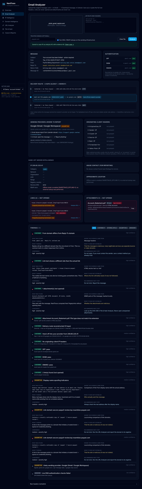
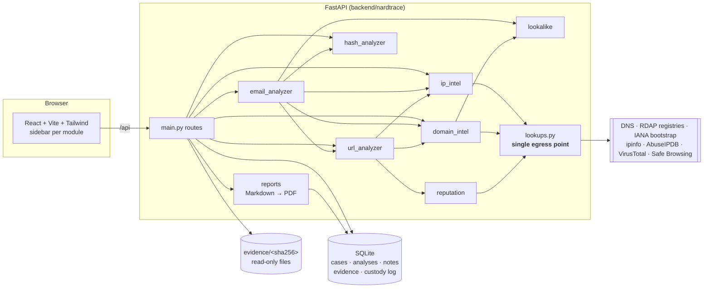
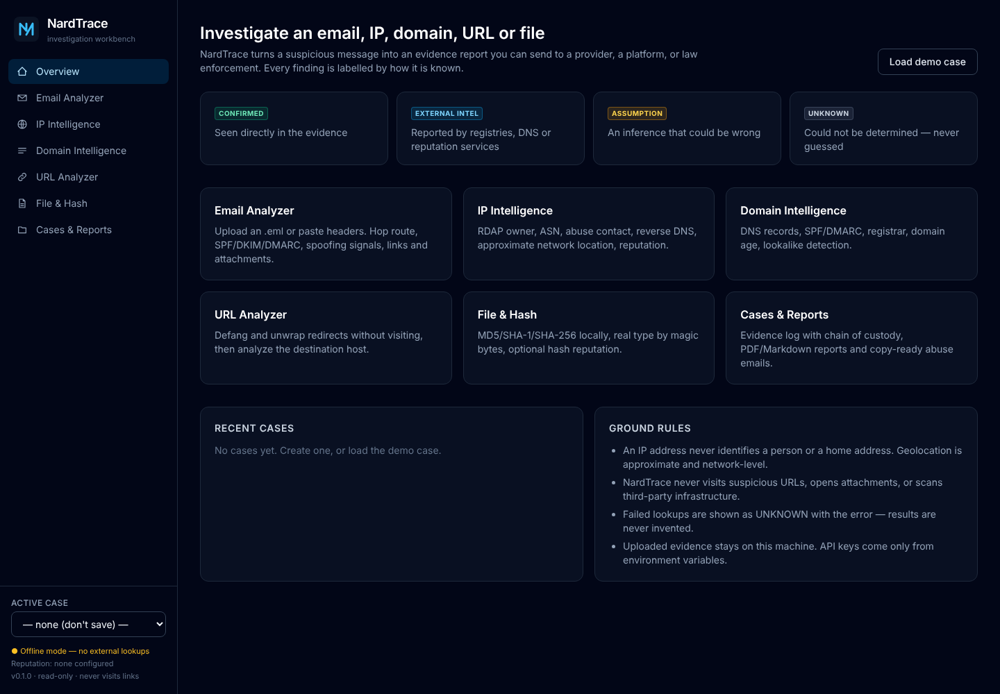
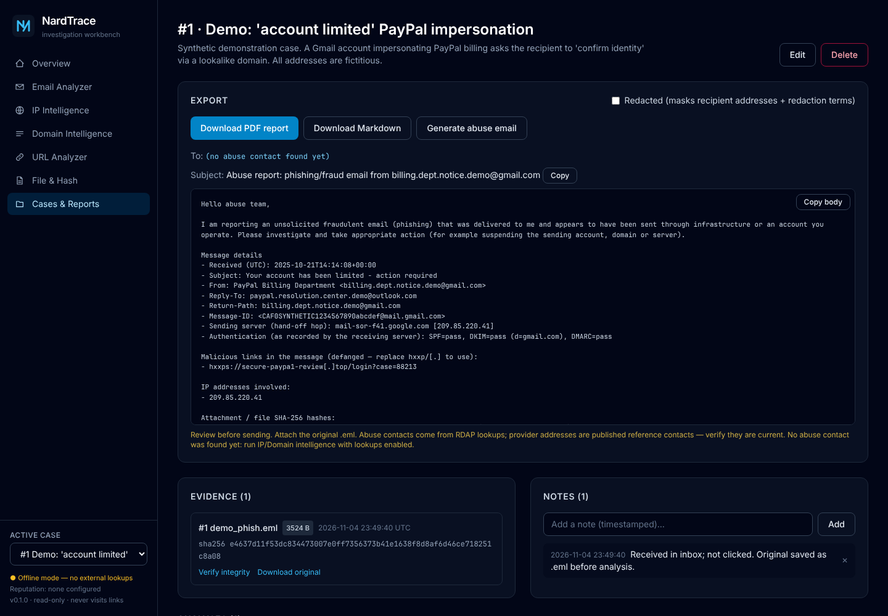
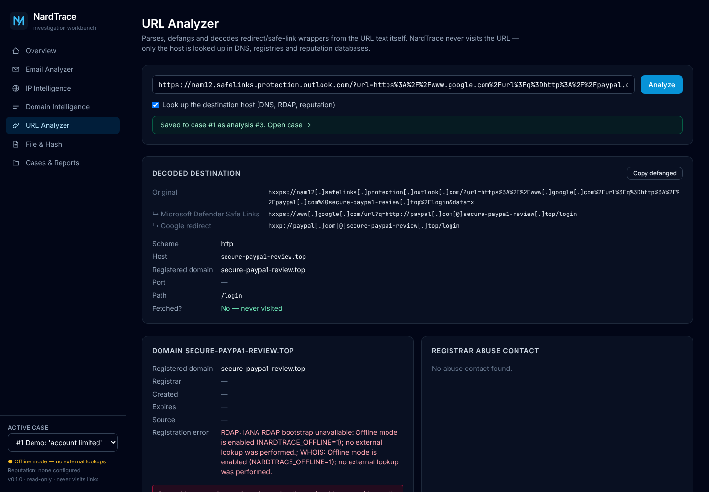
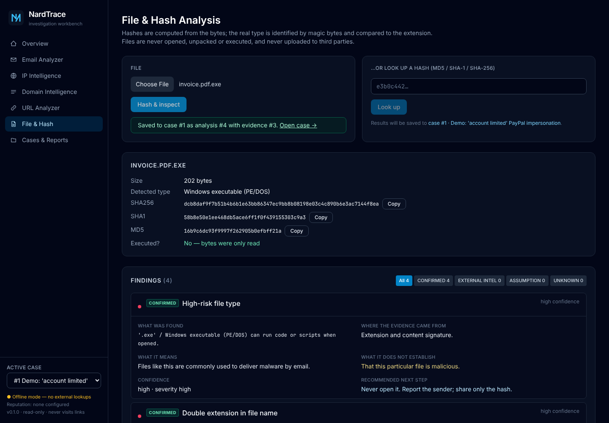

# NardTrace

**An email and infrastructure investigation workbench.** Open it any time to investigate a suspicious email,
IP address, domain, URL or file hash. It produces an evidence report you can send to a provider, a platform,
or law enforcement.

Built and owned by **Brianna Baynard**. The name plays on *Baynard* (bay-NARD).

NardTrace is **not** a one-off phishing checker, and it is **not** a tool for identifying or locating private
individuals. It identifies *infrastructure* (mail servers, networks, registrars) and the people responsible for
stopping abuse on it.



---

## What it does

| Module | Highlights |
|---|---|
| **Email Analyzer** | Upload an `.eml` or paste raw headers. Builds the `Received:` route (oldest → newest) with timestamps, hosts, IPs and per-hop delay. Finds the **hand-off hop** into the recipient's provider (the most reliable sender-side IP). Reports originating-client headers as *present* / *not present*. Parses SPF/DKIM/DMARC from `Authentication-Results` and checks them live in DNS. Flags From / Return-Path / Reply-To mismatches, display-name spoofing and lookalike domains. Lists links (defanged, wrappers decoded, text-vs-href mismatches) and attachments (hashes, true type). Identifies the likely sending provider. |
| **IP Intelligence** | RDAP owner, ASN, network range, registry country, **abuse contact (`abuse-c`)**, reverse DNS with forward confirmation, approximate network-level geolocation (always labelled), optional AbuseIPDB reputation. |
| **Domain Intelligence** | A, AAAA, MX, NS, TXT/SPF, DMARC, CAA. Registration via RDAP (IANA bootstrap) with WHOIS fallback: registrar, created/updated/expiry, **registrar abuse contact**. New-domain warnings (< 30 days high, < 180 days medium). Lookalike detection against a trusted domain and a built-in list of frequently impersonated brands. |
| **URL Analyzer** | Defangs and decodes Microsoft Safe Links, Proofpoint v2/v3, Google, Facebook and LinkedIn redirects, generic `?url=` parameters and base64-encoded targets, **all without fetching**. Structural red flags (`@` trick, raw IP, punycode, shorteners, odd ports). Domain and IP intelligence on the host. Optional VirusTotal and Google Safe Browsing lookups. |
| **File & Hash** | MD5, SHA-1 and SHA-256 computed locally. True type from magic bytes compared with the extension. Double-extension and high-risk-type warnings. Optional VirusTotal hash lookup. Nothing is executed or unpacked. |
| **Cases & Reports** | Cases collect analyses, notes and uploaded evidence. Every artifact is stored by SHA-256, with an append-only **chain-of-custody log** and one-click integrity re-verification. Exports **PDF and Markdown** reports, optionally **redacted**, plus a **copy-ready abuse email** addressed to the contacts found. |

### Every finding answers six questions

What was found · where the evidence came from · what it means in plain English · **what it does not establish**
· confidence · recommended next step. Every finding also carries exactly one evidence tag:

| Tag | Meaning |
|---|---|
| `CONFIRMED` | Directly observed in the evidence (headers, file bytes, link text) |
| `EXTERNAL INTEL` | Reported by a third party (RDAP, DNS, geolocation, reputation APIs) |
| `ASSUMPTION` | An inference or heuristic that could be wrong (provider identification, lookalikes) |
| `UNKNOWN` | Could not be determined. The lookup failed or data was absent, and the error is shown. Never guessed. |

---

## Quick start

### Docker (recommended)

```bash
cp .env.example .env        # optional: add API keys
docker compose up --build
```

Open **http://localhost:8000**, then click **Load demo case**. The port is bound to `127.0.0.1` only.
Data lives in the `nardtrace-data` volume.

### Local development

```bash
# Backend (Python 3.11+). WeasyPrint needs Pango: apt install libpango-1.0-0 libpangoft2-1.0-0
cd backend
pip install -r requirements-dev.txt
uvicorn nardtrace.main:app --reload --port 8000

# Frontend (Node 20+), in another terminal
cd frontend
npm install
npm run dev                 # http://localhost:5173 (proxies /api to :8000)
```

Or run `npm run build` once; the backend then serves `frontend/dist` at http://localhost:8000.

### Tests

```bash
cd backend && python -m pytest
```

The suite (47 tests) runs fully offline against **synthetic** `.eml` fixtures in `backend/tests/fixtures/`, which
contain no real personal data. CI (`.github/workflows/ci.yml`) runs the tests, builds the frontend, builds the Docker
image, and smoke-tests it by generating a PDF report.

### Configuration

All configuration comes from environment variables (see `.env.example`). **API keys are only read from the
environment and are never stored or returned by the API.** `/api/config` reports booleans only.

| Variable | Purpose |
|---|---|
| `ABUSEIPDB_API_KEY`, `VIRUSTOTAL_API_KEY`, `GOOGLE_SAFE_BROWSING_API_KEY` | Optional reputation lookups |
| `IPINFO_TOKEN`, `NARDTRACE_GEO_ENABLED` | Approximate geolocation (ipinfo.io) |
| `NARDTRACE_OFFLINE=1` | Disable **all** external lookups. Every lookup then becomes an explicit UNKNOWN. |
| `NARDTRACE_DATA_DIR`, `NARDTRACE_MAX_UPLOAD_MB` | Storage location and upload limit |

---

## Using it on a real email

1. **Save the original.** Gmail: *⋮ → Download message*. Outlook: *File → Save as*. Apple Mail: *File → Save As → Raw Message Source*.
   Don't forward it; forwarding destroys the headers.
2. **Create a case** (*Cases & Reports → New case*). Set the trusted domain (who the email pretends to be) and add
   your name and address as **redaction terms**.
3. With the case active, open **Email Analyzer** and upload the `.eml` with lookups enabled. The original is stored as
   evidence with its SHA-256.
4. Follow up on anything interesting: *Analyze URL →* on links, the hand-off IP in IP Intelligence, and the sender's domain.
5. **Export.** Download the PDF report (use *Redacted* for anything public), then **Generate abuse email** and send it
   to the listed contacts with the `.eml` attached.

See [docs/demo-case.md](docs/demo-case.md) for a fully worked example.

---

## Architecture



- **`lookups.py` is the only module that touches the network.** It performs DNS queries and read-only JSON API
  GETs and nothing else. It never connects to a suspect host. `NARDTRACE_OFFLINE=1` makes it refuse every call.
- **Findings** (`findings.py`) are a single dataclass with the six required fields and the evidence tag, so the UI,
  the PDF and the Markdown all render the same structure.
- **Evidence** is written once to `data/evidence/<sha256>` (mode 0440). The database stores its hashes. Every
  receipt, analysis, export, verification and download is appended to the custody log with a UTC timestamp.
- **Reports** are generated from the stored analyses as Markdown, then rendered to PDF with WeasyPrint. Raw headers
  are preserved verbatim in Appendix A. Redacted exports mask recipient addresses and case-specific terms.

```
backend/nardtrace/   FastAPI app and analysis modules       backend/tests/      pytest + synthetic fixtures
frontend/src/        React pages and components              docs/               demo case, Gmail design, screenshots
Dockerfile           multi-stage (Node build → Python slim)  docker-compose.yml  one service, localhost-bound
```

### Screenshots

| | |
|---|---|
|  |  |
|  |  |

*Screenshots were captured with `NARDTRACE_OFFLINE=1`, so RDAP, DNS and geolocation show as UNKNOWN. That is
the honest output when a lookup is not performed.*

---

## Ethics, limitations and responsible use

**Hard rules the code enforces**

- **No person identification.** No output claims an IP identifies a person or a home address. Every IP finding's
  *not established* field says so, and geolocation is always labelled *approximate, network-level*.
- **No active contact with suspect infrastructure.** NardTrace never visits URLs (`fetched: false` is part of
  every URL result), never opens or executes attachments, and never port-scans or probes anything. The only
  outbound traffic is DNS and read-only queries to registries and reputation databases.
- **No fabricated results.** A failed lookup becomes an `UNKNOWN` finding containing the actual error. The tests
  assert this in offline mode.
- **Privacy by default.** Evidence stays on the local machine. Nothing is uploaded to reputation services: only
  hashes, IPs and URLs are looked up, and only when a key is configured. Registrant identities are not unmasked.

**Limitations**

- `Received:` hops added before the recipient's provider can be forged. Only the provider's own hops are reliable.
- DNS and registration data reflect the time of lookup, not delivery time. The header verdicts are authoritative for delivery.
- Provider identification and lookalike detection are heuristics (tagged `ASSUMPTION`) and can be wrong.
- Clean reputation results do not mean something is safe, because new phishing infrastructure is usually unknown.
- Some ccTLD registries do not offer RDAP, and WHOIS fallback output varies by registry.

**Responsible use.** Use NardTrace on messages *you received* or are authorized to investigate. Send its output
to abuse desks, platforms and law enforcement, who can act on it lawfully. Don't use it to try to unmask or confront
an individual. If you have lost money or credentials, report to your bank, https://reportfraud.ftc.gov and
https://www.ic3.gov.

### Roadmap

- Gmail read-only integration where you pick one message: [design](docs/gmail-integration.md)
- Full SPF evaluation (`include:` expansion) against the hand-off IP
- Exporting a case as a signed evidence bundle (ZIP + manifest of hashes)

---

© Brianna Baynard. NardTrace is a portfolio project.
